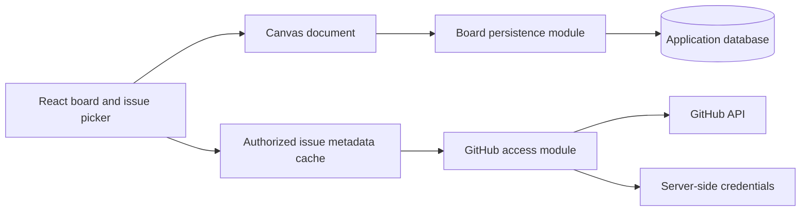

# GitHub issue and pull request canvas: implementation plan

Status: tldraw selected; self-hosted multi-user sign-in, private per-creator boards, view filters, and scheduled refresh in scope
Research date: 2026-11-05

## Selected direction

Build a self-hosted React + TypeScript web app using **tldraw with custom React/HTML issue and PR card shapes**. Anyone who authenticates through the GitHub App may use the deployment, including teammates sharing the app. Each person's boards and private GitHub access remain isolated; sharing the app does not imply sharing boards. The user tried both prototypes and selected tldraw, accepting its licensing tradeoff. This supersedes the earlier Excalidraw recommendation; do not implement an Excalidraw fallback or a dual-engine product. [Experiment report](experiments.md).

The tldraw 5.6.0 experiment demonstrated HTML-card stacking, frame clipping, dragging, metadata refresh without document changes, undo, snapshot reload, and explicit SVG export. Retain the custom-shape approach and validate a pinned SDK version for implementation. A valid production license/key remains a deployment requirement, not an unresolved engine choice. [Original research](canvas-research.md), [tldraw licensing](https://tldraw.dev/community/license).

Keep GitHub read-only. Canvas organization is a separate document, not a new representation of GitHub labels, milestones, or Projects fields. Use a GitHub App for private-repository access, and act with the signed-in user's authority. [GitHub research](github-research.md).

This is an implementation proposal backed by fixture-only browser experiments, not an implemented private GitHub application. Private GitHub authentication, durable deployment, schema migration, and production access-loss handling remain separate acceptance gates.

## Requirements and planning assumptions

### Requested behavior

- An interactive canvas containing cards for **both GitHub issues and pull requests** from one or more repositories, primarily private repositories.
- Useful metadata on each card, with explicit issue/PR kind and appropriate status.
- Dragging and spatial grouping to organize the cards.
- Freehand drawing and text on the same canvas.

### Settled scope and recommended implementation boundaries

The user has settled tldraw, self-hosting with GitHub App sign-in available to anyone who authorizes it, primarily private repositories, inclusion of PRs, view filters, and on-load/manual/scheduled refresh. The earlier single-owner allowlist and exclusion of additional users are superseded. Desktop-first interaction and the remaining boundaries below are implementation recommendations:

- Desktop-first; mouse, trackpad, and keyboard. Verify touch interactions, but do not promise a complete mobile editing experience initially.
- Upsert an application user by immutable GitHub user ID after successful sign-in; no configured single-owner allowlist. Save boards on the self-hosted server for reopening across that user's sessions/devices. Boards are private to their creator by default. Board-sharing permissions are a separate, undefined decision; do not infer team boards, invitations, shared links, or live collaboration from sharing the app within a team.
- GitHub.com public and private repositories; private access is core scope. GitHub Enterprise Server is a separate host/configuration decision.
- Explicitly selected issues and PRs, not an automatic mirror of every repository.
- Read-only metadata, refreshed on load, on a cost-aware adjustable schedule, and by an explicit Refresh button. No issue/PR creation, editing, closing, merging, or label changes. CI/checks, review summaries, and mergeability are not promised.
- Native text, drawing, arrows, groups, and labeled frames. No custom workflow/kanban engine.
- JSON board export/import for recovery and portability. Image export is optional and must correctly render custom cards before it is exposed.
- No arbitrary web embeds, external file uploads, image ingestion, or URL unfurling in the initial product; disable unrelated built-in entry points.

A browser-local prototype using explicitly labeled fixtures or public data can precede this scope. It is a throwaway feasibility experiment, not evidence that durable private-repository support works.

## User workflow

1. Sign in through the GitHub App; create or update the application identity using the returned immutable GitHub user ID. Authorize and select private repositories through relevant account/organization installations.
2. Create or reopen one of your private boards. Another person's app login or repository access does not grant access to your board.
3. Choose one or more repositories. Browse paginated issues and PRs, optionally filtering by kind and supported repository filters. Distinguish filtering loaded results from searching all GitHub records.
4. Add selected records through a button or drag them from the list onto the canvas. Also accept validated GitHub issue and PR URLs.
5. Move cards, multi-select, group/ungroup, place them in labeled frames, and add drawings, text, and arrows.
6. Select a card to inspect its full metadata in a side panel. Use an explicit link to open GitHub; dragging the card must never navigate.
7. Reopen the board with the same layout. Refresh on load, by schedule, or by button updates issue/PR metadata without rebuilding the scene. Filter the view without deleting or moving placements; show the hidden count and a clear/reveal action.

### Card behavior

- Show repository + number, issue/PR kind, title, labels, assignees, and freshness. Issues show open/closed with state reason where available. PRs distinguish draft, open, closed-unmerged, and merged; missing PR detail is unknown, not assumed unmerged. See retrieval below for the extra PR fields.
- Bound label and assignee display; put overflow and full titles in the detail panel. Do not fetch issue bodies/comments merely to render cards.
- Use stable card geometry; a changed title or label must not change card positions or automatically expand a frame.
- Treat each placement as its own canvas shape. Multiple placements may reference the same issue or PR, including copies on the same board; they share one metadata entry. Adding an already-placed record through the picker focuses its existing placement unless the user explicitly requests another copy.
- Deleting a placement only removes it from the board. Undo restores the placement. Closing an issue or closing/merging a PR on GitHub changes its status, not its presence on the board.
- Groups move selected objects together. Frames provide labeled spatial areas. Neither changes GitHub metadata.
- Keyboard-accessible issue list and detail panel provide alternatives to pointer-only card inspection and insertion. Verify selection, movement, grouping, deletion, link activation, and focus return on the actual canvas.

### View filters and planning-field mapping

- Support hiding closed issues and hiding merged PRs independently, plus include/exclude rules for labels, weight, sprint, and type. Issue/PR kind remains distinct from a mapped planning type.
- Filters are per-user, per-board view state, not GitHub writes or canvas-document mutations. Combine active filters with AND. Label mode is explicit: Include matches at least one selected label; Exclude rejects any selected label. No selected labels imposes no label restriction.
- Unset values are not zero, an empty sprint, or an invented type. Offer an explicit Unset choice; a concrete value/range does not match unset. Keep unavailable/unfetched data distinct from a confirmed unset field and mark incomplete filtering rather than claiming a complete result. Do not infer merged status from a missing PR field.
- Hide nonmatching placements without deleting, moving, resizing, regrouping, or reflowing them; retain their slots, reference IDs, and geometry. Refresh may change whether a placement matches, not its saved position. Show a hidden-placement count (not just distinct source count) and Clear filters / Reveal all, restoring the same placements in place. Filters do not revoke access or change exports into a permission boundary.
- **Mapping gate before real GitHub integration:** choose actual sources for weight, sprint, and type from available GitHub Projects/custom fields, labels, or native fields where supported. Define field IDs, value normalization, cross-repository/project conflicts and precedence, and unset/unavailable semantics. Do not present all three as universal standard issue fields or equate planning type with issue/PR kind. UI fixtures must label these as mock planning values.
- Projects read-only permissions may be needed once a source is chosen; the exact endpoint/query and permission coverage are not yet proven. Do not request extra permissions or promise Projects access before that gate. No new API research or implementation is implied by this scope update.

## Architecture

### Proposed stack

- **Client:** React, TypeScript, Vite, tldraw, and a query cache for normalized GitHub metadata. Render cards as custom React/HTML shapes subscribed to that cache, with explicit GitHub links and a list/detail panel.
- **Server:** a single TypeScript/Node application for GitHub authentication, authorized issue/PR retrieval, and board persistence. Fastify is a reasonable default; no microservices or worker fleet needed.
- **Storage:** SQLite on durable local disk for application users, user-scoped sessions and encrypted GitHub credentials, authorized reference contexts, and versioned private board snapshots. Back up the database consistently and keep encryption-key recovery separate and protected. A shared self-hosted deployment does not require hosted PostgreSQL.
- **Deployment:** one self-hosted application origin for the client and backend, behind HTTPS, with a persistent data directory and backups. No WebSocket server or separate database service is needed for private per-creator snapshot persistence.

### Module responsibilities

| Module | Interface | Hidden implementation and invariant |
| --- | --- | --- |
| Board editor | Open document; add issue/PR placements; emit document changes | Canvas shapes, selection, grouping, drawing, text, history, and custom card rendering. No GitHub requests during rendering. |
| Board persistence | Load board; save against an expected revision; export/import | Per-creator board authorization on every operation, snapshot validation/migrations, durable writes, save conflicts. No metadata refresh logic. |
| GitHub access | List accessible repositories; list issues and PRs; resolve/refresh references | User authorization, pagination, kind/status normalization, credentials, conditional requests, and access errors. Never returns data solely because an installation can see it. |

Use the selected canvas SDK directly inside the board editor. Do not build a generic multi-engine canvas abstraction or support both engines at runtime. The durable seam is between the canvas document and GitHub metadata.

## Data ownership and persistence

| Data | Authority | Proposed representation |
| --- | --- | --- |
| Application user | GitHub-authenticated identity | Upsert by immutable GitHub user ID; login/email are mutable display attributes, not authorization keys |
| Board ownership and title | Application | `Board { id, ownerUserId, title, revision, document, updatedAt }` |
| Positions, dimensions, groups, frames, arrows, text, drawing | Canvas document | Native SDK records and schema version; no duplicate layout tables |
| Issue/PR placement | Canvas document | Custom tldraw shape with validated/versioned reference, kind, and dimensions in props; native shape record owns placement, parent, rotation, and stacking |
| Issue/PR identity | Application reference mapped to GitHub | Immutable internal `itemReferenceId`; registry stores `kind: "issue" \| "pull_request"`, host, opaque node IDs, separately named REST issue/PR IDs, repository ID, and mutable number/URL locators |
| Title, labels, assignees, state, timestamps | GitHub | Normalized metadata keyed by item reference and authorization context; PR `draft`, `merged`, and `mergedAt` enrichment separate from shared open/closed state; freshness and access status separate |
| Weight, sprint, planning type | Chosen GitHub source, pending mapping gate | Authorized normalized values with source/field provenance; unset and unavailable distinct; fixtures are not proof of native fields |
| Camera, selection, tool state, filters, refresh preference | User view/session | State scoped by signed-in user and board, outside the canvas document and GitHub writes |
| GitHub tokens and refresh tokens | Server | Per-user encrypted credentials, never shape props, snapshots, exports, logs, or browser storage |

Do not key identity only by `owner/repo#number`: those are locators, not the application's immutable identity. Shapes use an internal reference so GitHub locator or node-ID migrations do not rewrite placement identity. Store provider IDs losslessly and treat node IDs as opaque; remap only on trusted API evidence. Verify rename/transfer behavior during integration rather than claiming all transfer cases preserve provider identity. See [GitHub research](github-research.md).

### tldraw implementation direction

- Register a custom `BaseBoxShapeUtil` with `HTMLContainer`. Persist item reference/kind and dimensions in validated shape props; use native shape records for layout, grouping, frame membership, and history. Add custom-prop migrations before the schema evolves.
- Keep GitHub metadata outside the tldraw document and undo history. Subscribe card renderers to an authorization-aware cache keyed by current user/authorization context and item reference, not a network request per placement or a cross-user private cache. Refresh changes displayed metadata without moving/resizing shapes, replacing the document, or generating layout saves.
- Keep noninteractive card content canvas-owned for selection and dragging. Only explicit links/buttons take pointer ownership; dragging never opens GitHub. Preserve stable card dimensions when metadata changes.
- Use native grouping, frames, drawing, text, and arrows. Batch insertions into one user action and convert sidebar drop coordinates through the SDK utilities. Do not build a second layout or grouping model.
- Persist the SDK document snapshot and its schema; keep camera/selection session state separate. Listen to document-scope changes and coalesce revisioned server saves. Do not run independent local and server persistence authorities.
- Provide meaningful shape text/accessibility descriptions, semantic controls, and a keyboard-accessible list/detail panel. Verify focus and actual keyboard/screen-reader behavior rather than treating HTML rendering as proof of accessibility.
- The prototype proves explicit browser-local snapshot reload, not durable persistence or schema migration. Implement reference-aware clipboard/import handling and authorized metadata hydration separately. See [experiment details](experiments.md).

### Save and recovery contract

- `GET /api/boards/:id` returns the authorized document and revision. `PUT /api/boards/:id` supplies the expected revision and the new validated document.
- A successful save atomically advances the revision. A stale revision yields a conflict; preserve the local draft and offer reload or save-as-copy, never silent last-writer-wins.
- This handles accidental editing in two tabs/devices without pretending to be multiplayer.
- Show Saving / Saved / Unsaved / Conflict based on acknowledged state. Keep a recovery draft keyed by account and board; never silently replace a newer server document with it.
- Validate imported file size, schema, allowed record types, and issue/PR references before creating a new board. Reauthorize metadata retrieval after import. Unsupported future schemas must not be loaded destructively.
- JSON export contains the document and a reference manifest mapping internal reference IDs to GitHub host/node IDs, not credentials or a private-issue cache dump. Import validates the manifest, resolves nodes under the importing user's authority, and remaps internal references as needed; an unresolved source preserves an unavailable placement. User-written notes may still be sensitive; exports are not public by default.
- Maintain database backups and exercise restore before launch. Browser IndexedDB is a recovery layer, not the only durable copy: browser storage can be evicted or cleared. [MDN storage behavior](https://developer.mozilla.org/en-US/docs/Web/API/Storage_API/Storage_quotas_and_eviction_criteria).

### Export caveat

A reference-only snapshot cannot render current metadata on its own. Resolve references under current authorization after restore. If visual export is exposed, implement an explicit `toSvg` card renderer using a consistent snapshot of authorized metadata; the tldraw experiment included card metadata and frame clipping correctly through this path. Visual exports contain private data that cannot be retracted after export. Keep them intentional and separate from reference-only board JSON; validate clipboard/import references before metadata retrieval. Do not promise lossless interchange with Excalidraw. [Evidence](experiments.md).

## GitHub integration

### Authentication and authorization

- Register a GitHub App with **Issues: read**, **Pull requests: read**, and required **Metadata: read** repository access. Issues/read supports the shared issue/PR list and common metadata; Pull requests/read supports PR enrichment. Do not request Contents, Checks, Actions, Commit statuses, organization Members, or any write permission for the current scope. [Permission evidence](github-research.md#1-decision-summary).
- Weight/sprint/type source mapping may require additional Projects read-only permission. Its necessity and exact permission/query coverage remain unverified; choose and validate the mapping before extending this baseline.
- Use GitHub's user web authorization flow with state validation and PKCE; keep the code exchange and credential storage on the server. Use secure HttpOnly session cookies and protect state-changing application requests from CSRF.
- After server-side `GET /user`, upsert the application user by the returned immutable GitHub user ID and establish that user's session. Anyone who successfully authorizes through the GitHub App can sign in; do not apply an owner allowlist or identify accounts by mutable username/email. Enforce the current-user/session boundary on every application route. Shared hosting is not shared authorization.
- Prefer expiring user access tokens and implement refresh/re-authorization. App installation and user authorization are separate concepts; private repos across account/organization owners may require several installations and organization approval.
- For interactive and scheduled reads, use the relevant user's GitHub App user access token: GitHub limits it to the intersection of that user's access and the app's access. Installation-wide access is not a bypass for scheduled refresh or proof the current viewer may see an issue. [User access tokens](https://docs.github.com/en/apps/creating-github-apps/authenticating-with-a-github-app/generating-a-user-access-token-for-a-github-app).
- Public reads are an exception to requiring an installation: GitHub Apps acting for a user have implicit public-read access. Allow public repository URLs outside the installed-repository picker; this does not grant installation webhook coverage. [Permission selection](https://docs.github.com/en/apps/creating-github-apps/registering-a-github-app/choosing-permissions-for-a-github-app).
- Enforce private per-creator board access and current-user metadata authorization independently, including list/load/save/delete/export and reference resolution. Scope credentials, repository discovery, server/client metadata caches, conditional validators, and in-flight work by user/authorization context. A valid board ID, issue node ID, teammate login, or shared installation grants no cross-user access.

### Retrieval and refresh

- Start with shared repository REST listing `GET /repos/{owner}/{repo}/issues` and common detail `GET /repos/{owner}/{repo}/issues/{number}`. Keep both kinds: presence of `pull_request` means a PR, not a record to discard. Accept `/issues/{number}` and `/pull/{number}` URLs and verify the returned kind. Follow pagination and explicitly mark partially loaded results. Add a small authenticated GraphQL node-resolution path for reference imports with both Issue and PullRequest type handling. [REST issues](https://docs.github.com/en/rest/issues/issues), [global node IDs](https://docs.github.com/en/graphql/guides/using-global-node-ids).
- Shared responses can include optional `draft` and `pull_request.merged_at`; do not assume those fields are always present. Fetch `GET /repos/{owner}/{repo}/pulls/{number}` for selected PRs when complete status or requested detail needs enrichment, using Pull requests/read. Normalize merged first, then closed-unmerged, then draft/open; while required fields are absent, show unknown/detail-loading rather than inventing status. `/pulls` listing is optional for PR-specific filtering, not a second mandatory repository mirror. No review/CI endpoint is part of the initial plan. [PR API](https://docs.github.com/en/rest/pulls/pulls), [GitHub research](github-research.md#4-rest-and-graphql-fetching).
- Do not use GitHub search as an unlimited repository crawler. If global search is added, expose its query semantics and completeness limits.
- Refresh placed issues and PRs independently from the picker query, including placements hidden by view filters. Disappearing from an open-only list does not mean a placement should be removed.
- Request on board load, explicit Refresh, and an adjustable schedule. Exact cadence is TBD from measured request count (including PR enrichment and mapped planning fields), remaining rate budget, distinct board source volume, and latency; do not promise an arbitrary fixed interval.
- Deduplicate repeated references within the same authorization context and coalesce overlapping load/manual/scheduled requests already in flight. Use conditional requests where supported. Pause scheduled work for hidden/inactive boards; revalidate when visible again. Avoid multiplying work across tabs.
- Keep scheduled requests user-authorized; expired/revoked credentials pause work and require refresh or reauthorization, never an installation-token fallback. Rate-limited or temporarily unavailable repositories leave layout intact. Honor retry/reset headers and back off centrally rather than retrying independently per card.
- Show last successful refresh, next scheduled refresh (or paused/backoff reason), in-progress state, and per-source freshness/errors. Do not turn partial success into a misleading board-wide success flag. See [GitHub research](github-research.md) for documented conditional behavior and rate limits.
- Render titles and labels as text, not arbitrary HTML. Parse supported GitHub issue/PR URLs and construct API requests; do not proxy arbitrary user-provided URLs.

### Access loss and privacy

- Separate unavailable/not-authorized, missing/unresolvable, transient failure, and successfully refreshed states; a private-resource 404 is not proof of deletion.
- On detected revocation or loss of access, remove affected metadata from the shared cache and render anonymous unavailable cards in the same placements. Keep titles, labels, and other fetched metadata out of shape props and history so undo cannot restore revoked content. Clear metadata, details, and any in-app visual export previews on logout/account change. Already downloaded exports cannot be revoked.
- Use user-token reads of the delivered issue/PR representations (conditional where supported) or authorized node lookup before each server delivery of private metadata, including cached results and exports. A successful common issue read must not authorize cached PR enrichment after Pull requests permission is lost. Scope caches to authorization context; do not serve private metadata from a shared CDN cache. A future permission-cache TTL introduces an explicit stale-access window, not equivalent request-time authorization.
- Keep private metadata out of persisted browser query caches; clear in-memory metadata on logout/account change. A transient error may show already-seen session data as stale, but must not be treated as renewed authorization.
- Scheduled/manual refresh cannot provide instantaneous detection of upstream permission changes. Revocation events/access revalidation reduce this window; neither can retract information the user already saw or exported.
- Boards are private per creator. Multiple people may use the same deployment, but sharing permissions remain undefined; no team-board membership, invitation, or collaboration system is implied.

### Optional later synchronization

Issue/PR-update webhooks are optional; on-load, scheduled, and manual refresh are current scope. Live collaboration is not implied by allowing multiple people to sign in.

- **Issue/PR webhooks, only if later needed:** subscribe to `issues` and `pull_request` with the corresponding read permissions; verify signatures over raw request bytes, deduplicate delivery IDs with processing status, durably queue before acknowledgment, then refetch canonical metadata. Send client invalidations, not unchecked installation-token payloads. Handle app authorization/installation changes and rediscover repository grants: removal arrays can be empty on all-to-selected changes. GitHub does not automatically redeliver failures, and GitHub Apps do not receive a complete repository deletion/transfer log. Keep reconciliation and request-time authorization. [Webhook findings and primary sources](github-research.md#8-webhook-stage-and-revocation).

## Implementation sequence and acceptance gates

| Stage | Deliverable | Acceptance gate |
| --- | --- | --- |
| 1. Resolve engine risk — complete | User selected tldraw after trying both prototypes; runnable comparison retained on prototype branch | tldraw browser evidence covers layering, clipping, drag, refresh/undo, snapshot reload, and explicit SVG export. This is not proof of private integration, accessibility, production scale, or licensed deployment. |
| 2. Complete local board workflow | Shared issue/PR card, picker insertion, multiple placements, groups/frames, text/drawing, view filters, local recovery and JSON round-trip | Place both kinds from two public repositories, arrange them with notes/drawings, reload, and recover the same arrangement. Refresh never changes geometry or enters undo history. PR draft/open/closed/merged remain distinct. Combined filters hide and reveal original placements in place; unset differs from zero, hidden counts are accurate, and clearing restores the view. |
| 3. Add secure GitHub access | GitHub App sign-in/upsert/install flow for multiple users, isolated repository picker/caches, server fetching, pagination, mapped planning fields and on-load/manual/scheduled refresh | Two independently authorized GitHub users can sign in; each sees only their own boards and authorized private records. Board/source IDs, shared installations, and cached or in-flight responses cannot cross users. Exercise token refresh, uninstall/revocation, missing Issues/Pull requests permissions, and multiple repository-owner installations. Prove chosen planning-field mapping/permissions; measure cadence costs and exercise hidden-board pause, coalescing, conditional responses, backoff, and last/next status. |
| 4. Add durable boards | SQLite on durable disk, revisioned saves, recovery/conflicts, schema validation/migration and backups | Reopen from a new browser session as the same user; another user cannot list/load/save/delete/export that board. Survive backend restart; two tabs cannot silently overwrite; failed saves stay visibly unsaved; restore a consistent backup and import an older supported document. |
| 5. Verify usable scale and release path | Browser interaction checks, access-loss checks, measurements, self-hosted deployment configuration and license | Complete the workflow with real issues and PRs plus drawings/text. Verify keyboard alternatives and long/Unicode titles. Confirm production-build licensing, HTTPS, per-user isolation, durable storage, and restore before calling the app deployable. |

Stages describe implementation order, not separate products or claims that an incomplete stage satisfies the whole request. Stages 3 and 4 can proceed independently once the document/reference contract is settled. Create separate local tracker tickets under `issues/NN-slug.md` when the assumptions and engine choice are accepted.

### Performance experiment, not a vendor guarantee

The [experiment report](experiments.md) records exploratory production-bundle measurements for Excalidraw only. Those results do not establish tldraw capacity. The selected tldraw prototype was exercised functionally in development mode; no production performance benchmark or licensed deployment has been verified.

Target ordinary boards in the hundreds of placements initially, subject to measurement rather than a capacity promise. Before release, benchmark the pinned tldraw production build on representative users' browsers/laptops with mixed drawings/text, realistic titles, repeated metadata refresh, and long sessions. Measure memory and input latency as well as frame intervals. Share metadata subscriptions among repeated placements within one authorization context and do not fetch every repository issue merely to open a board.

### Regression coverage worth keeping

- Same number in two repositories does not collide; repeated placements share metadata but retain independent positions. REST issue IDs and PR IDs are not conflated during enrichment.
- Multi-page import retains both issues and PRs, handles PR-only pages, applies optional kind filtering without stopping pagination, and never reports partial results as complete.
- Issue closure and PR draft/open/closed/merged transitions update card content without deleting/moving placements or changing user undo history; missing enrichment is not silently treated as closed-unmerged.
- Snapshot round-trip and schema migration preserve references, text, drawings, groups, and bindings.
- Conflicting/failed/out-of-order saves cannot silently lose edits.
- Private metadata cannot cross account/session/cache contexts; access loss removes metadata without losing layout.
- Two authorized users on one deployment cannot access each other's boards, credentials, repository-picker results, metadata, recovery drafts, or in-flight refresh results; account switching clears the prior user's view.
- Closed-issue, merged-PR, include/exclude label, weight, sprint, and type filters combine with AND; explicit unset is not zero; hidden placements retain geometry and return on clear, including repeated references.
- Load/manual/scheduled triggers coalesce and deduplicate without crossing authorization contexts; hidden boards pause, rate limits back off, and last/next status reflects partial failures and reauthorization.

Also perform real-browser smoke runs. Unit tests alone cannot prove canvas hit testing, drag/drop coordinates, frame parenting, focus behavior, or card-export fidelity.

## Settled decisions and remaining gates

**Settled by the user:** tldraw selected after trying both prototypes; self-hosted app usable by anyone who authenticates through the GitHub App, including teammates using one deployment; primarily private repositories; issues and PRs; read-only view filters; on-load/manual/scheduled refresh; tldraw licensing acceptable but not ideal.

**Visual direction:** Atlas's light, canvas-first layout and technical card styling are selected. Replace the modal-heavy interaction model with non-modal controls; compare a docked inspector, bottom shelf, and contextual anchored panels before selecting the interaction pattern.

**Incoming tray:** newly discovered issues and PRs enter a separate unplaced queue, never random canvas positions. Drag a candidate onto the board to choose its position, with an Add to board alternative for keyboard/single-pointer use. Placing an item removes that candidate from the queue; metadata refresh never relocates existing placements. Incoming candidates and already-placed cards hidden by view filters are distinct sets. Real discovery/subscription rules and queue persistence still need definition; the interaction study uses fixtures.

**Recommended baseline:** upsert users by immutable GitHub ID, private per-creator boards, isolated current-user GitHub access/caches, SQLite on durable disk with backups, and server-side credentials. The former single-owner allowlist/no-additional-users recommendation is superseded. No PAT shortcut or broad code-read permission.

**Engine locked:** tldraw custom React/HTML card shapes; no Excalidraw fallback. **Implementation gates:** obtain the appropriate production license/key; prove private installation/organization approval for each user's sources; implement persistence/security; choose and validate weight/sprint/type source mapping and any required Projects read-only permission; measure refresh costs and choose adjustable cadence; validate accessibility and working-board scale.

**Decisions deferred, not blockers for fixture UI:** board-sharing roles/permissions (boards stay private until separately specified); concrete planning fields/projects/labels and cross-source precedence; refresh interval defaults and adjustment bounds based on measurement; whether visual export is required and its privacy policy. Fixture controls may demonstrate these views and simulated refresh without claiming real API mapping or scheduling.

Read-only metadata is the boundary. CI/checks, reviews, mergeability, write-back to labels/status/Projects, board sharing, and multiplayer require separately agreed scope before adding permissions or endpoints.

## Research and evidence

- [Canvas comparison and sources](canvas-research.md).
- [GitHub integration research and sources](github-research.md).
- Primary tldraw persistence, shapes, history, export, and licensing documentation linked above.
- Earlier research recorded a live unauthenticated [repository issues request](https://api.github.com/repos/excalidraw/excalidraw/issues?state=open&per_page=2) returning two PR-shaped records with `pull_request`. That observation remains valid; its earlier **PR-exclusion recommendation is superseded by the user's request to include PRs**. It now supports kind discrimination, not filtering PRs out. This was not a private-repository/authentication test.
- [Real browser experiments and evidence](experiments.md) cover Excalidraw embeds, native SVG-image cards, and tldraw custom shapes. Both prototype builds passed; Excalidraw performance used its production bundle, while tldraw interaction checks used normal development licensing. No private GitHub login, server-backed durability, or deployment was exercised.
- Initial visual UI studies are captured on local branch `prototype/ui-directions`, in sibling worktree `../gitboard-canvas-prototype`. They compared Studio, Dispatch, and Atlas; the user selected Atlas and requested less modal-heavy interactions. The branch's `tldraw/README.md` documents fixture controls and screenshots. These are appearance studies, not real authentication, GitHub field mapping, scheduled network refresh, or production canvas behavior.
